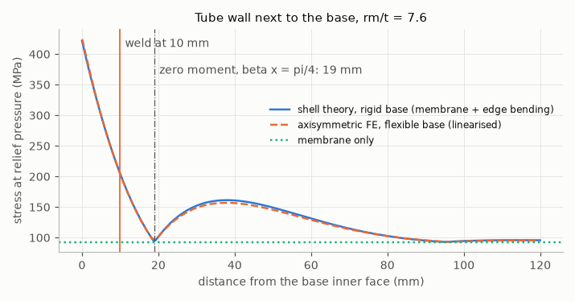
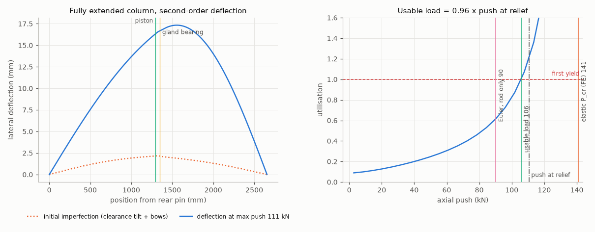
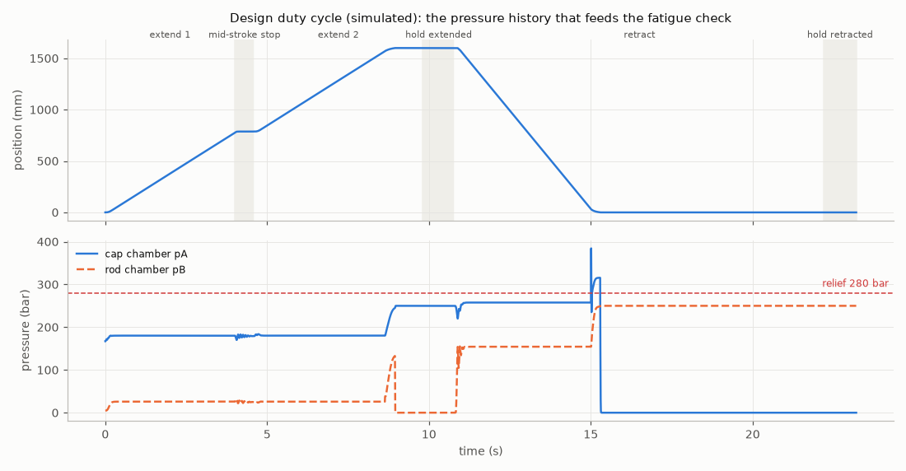
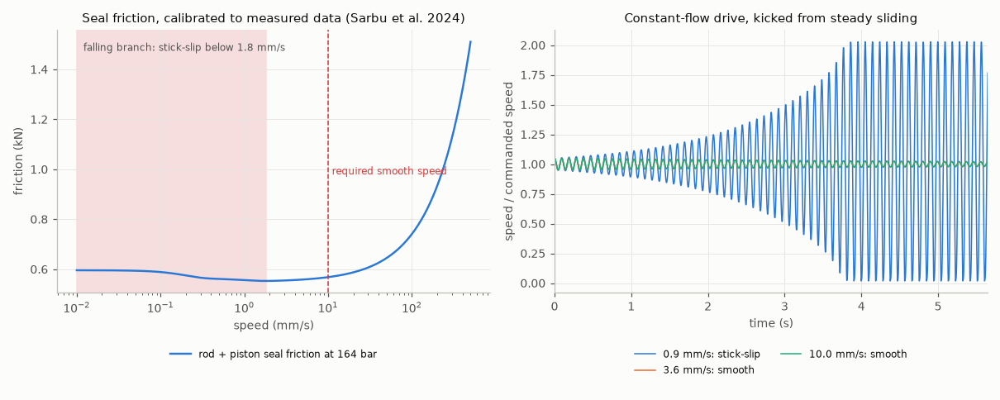

# Hydraulic cylinder: order spec → verified design → acceptance test

A make-to-order cylinder shop turns each order line (bore, rod, stroke, pressure, mounting, duty) into a design. The usual checks are static: a Lamé wall thickness and an Euler rod check. Then a final pressure test. Neither shows the failures that actually end a cylinder's life in the field.

This project takes one order file and does the whole chain. It sizes the design, then finds where the real margins are:
- buckling of the whole stepped column;
- fatigue under the simulated duty;
- cushion peaks;
- stick-slip;
- drift;
- natural frequency.

It derives the requirements, FMEA and acceptance-test pass limits from those numbers. Finally, it hands the part dimensions to the [CNC part-family generator](https://github.com/chad416/cnc-part-family-generator), which writes and verifies the lathe programs.

The engineering argument, structured as a systems-engineering dossier after Wasson (2016), is in **[DOSSIER.md](DOSSIER.md)** ([PDF](DOSSIER.pdf)). The full calculation reports are [reports/HD-160.md](reports/HD-160.md) and [reports/LD-80.md](reports/LD-80.md).

**Everything here is analysis and simulation.** No cylinder was built or tested. Seal friction is calibrated to a published test series (two open-access papers); the extrusion-gap limits come from a seal maker's installation tables. The ISO/TS 13725 equations were not available, so the buckling model follows the standard's principles with a classical beam-column FE. See [Limits](#limits).



## What it found (two illustrative orders)

| | HD-160 rev A (as ordered) | HD-160 rev B | LD-80 rev A (as ordered) | LD-80 rev C |
|---|---|---|---|---|
| bore / rod / stroke (mm) | 160 / 100 / 1600 | same | 80 / 50 / 1200 | 80 / 63 / 1200 |
| static checks (Lamé, base, rod, thread) | pass | pass | pass | pass |
| first yield / push at relief (buckling) | 1.65 | 1.65 | **0.96** | 1.65 |
| governing fatigue stress factor | **0.33** (port in tube wall) | 1.03 (base weld) | **0.35** (port in tube wall) | 1.10 (base weld) |
| cushion chamber peak, 0 °C oil | **446 bar** (relief 280, proof 420) | 324 bar | **463 bar** (relief 220, proof 330) | 273 bar |
| requirements not met | R-08, R-10, R-13 | R-13 (spec issue) | R-07, R-08, R-10 | none |
| lathe programs via project 07 | | rod end, piston, gland PASS (gland with a heavier grooving bar) | | rod end, piston, gland PASS |

1. **The base weld, not the tube, sets the fatigue life.**
   - The flat base stops the tube growing, which bends the wall next to it.
   - At the original weld position (10 mm from the base face) the HD-160 stress factor is 0.38.
   - Moving the girth weld to where the edge moment changes sign (βx = π/4, 19 mm) gives 1.03 with the same tube.
   - An independent axisymmetric FE model of tube and base confirms the zero-moment point: 18.9 mm against 19.0 mm from the shell formula. The fatigue check uses the FE stress, which is 6 % higher at the weld.
   - A stronger, thinner 25CrMo4 tube makes it worse (0.54): weld S-N curves do not improve with parent-metal strength.
2. **The port relief valve does not protect the cushion chamber.** The overrunning load retracts the HD-160 at 0.41 m/s against a 0.20 m/s order speed, and the cap cushion peaks at 446 bar with cold oil. The fix is a system-level interface requirement: limit the retract command. A stronger tube would not fix it.
3. **Buckling margins depend on the clearances, not only on the rod.**
   - Rod-only Euler says LD-80 rev A is at 0.82 × the push, and the elastic stepped column says 1.28 ×. With the rod tilt allowed by the bearing clearances, bow, pin eccentricity and self weight, first yield is at 0.96 ×.
   - A 56 mm rod peaks at 1.33 × near a 100 mm stop tube; longer stop tubes make it worse.
   - A 63 mm rod with a 50 mm stop tube reaches 1.65 ×.
4. **One order requirement cannot be met as written.** The 5 mm / 10 min drift limit is used up by 4.4 K of oil cooling in the locked HD-160 cap chamber, and the order gives no thermal condition. It goes back to the customer.
5. **Calibrate before concluding.** With assumed seal data, smooth motion at 10 mm/s looked infeasible (stick-slip onset 12 mm/s). Calibrated to measured seal friction (Sârbu et al., *Polymers* 2022 and 2024), the onset is 1.8 mm/s and the requirement is met. The calibrated model predicts the papers' measured onsets conservatively, within about 2 ×.
6. **The dynamic model reproduces the textbook results it should.** The model's natural frequency equals the oil-column formula (11.7 Hz at mid stroke, HD-160). As the valve gets fast, its position-loop gain limit converges to Merritt's K_v < 2ζω_h (to 0.90-0.95 ×; the rest is the single-rod asymmetry). With a critical-centre valve and tight seals, ζ ≈ 0.001-0.005, so a closed loop needs added damping.

## How it works

```
data/orders/*.json  ->  size tube (Lamé) and base (plate)  ->  analyses:
   stress.py     Lamé, plate bounds, base-junction edge bending, thread stress area
   axisym.py     axisymmetric FE of tube + base: checks the edge-bending solution, gives the weld stress
   buckling.py   stepped beam-column FE: P_cr, P-delta with clearance tilt, bows, eccentricity, self weight
   dynamics.py   valve + hoses + chambers + cushions + Stribeck friction + stops -> duty pressure history,
                 cushion peaks, natural frequency, loop-gain limit
   fatigue.py    rainflow (ASTM E1049) -> S-N (EN 1993-1-9 welds, machined steel, VDI 2230 threads) -> Miner,
                 equal-damage ISO 10771-1 type-test pressure
   seals.py      stick-slip onset (linear criterion + simulation), thermal drift, leak budget
-> requirements.py (status per requirement) -> fmea.py (occurrence from the computed margin)
-> acceptance.py (ISO 10100 modules L/P/F + cushion + type test, limits from the analysis; Stribeck fit of bench data)
-> aoa.py (seal system, rod coating, tube material; weights +-10 % and 2000 random weight sets)
-> cnc_bridge.py (rod end, piston, gland rows -> project 07: generate + verify lathe programs)
-> reports/*.md, docs/img/*.png
```







## Tests

`python -m pytest`: 27 tests. Each model is checked against an independent closed form or a published worked example:
- **Buckling FE:**
  - Euler for four end conditions (0.2 %);
  - the exact two-segment stepped-column equation;
  - the secant formula;
  - the 1/(1 − P/Pcr) amplification.
- **Lamé:** thin-wall limit and radial equilibrium.
- **Edge bending:** closed-form edge moment and the zero point at βx = π/4; the axisymmetric FE model against the shell solution (membrane, edge bending, zero point).
- **Thread stress area:** the ISO 898-1 tabulated value for M20.
- **Rainflow:** the ASTM E1049 example, exact counts.
- **Weld S-N:** knee points and cut-off.
- **Dynamics:**
  - natural frequency vs the eigenvalue;
  - loop gain converging to Merritt's rule;
  - cushion needle trade;
  - relief not protecting the cushion.
- **Seals:** the calibrated model against the measured stick-slip onsets (PTFE, PU); stick-slip simulation agreeing with the linear criterion; thermal drift by hand.
- **Design decisions:** the LD-80 buckling iteration and the HD-160 fatigue fix.
- **Acceptance evaluator:** catches a sticky seal set.
- **CNC hand-off:** accepted by project 07.

## Run it

```bash
pip install -r requirements.txt
python -m pytest
python -m cylver report                 # all orders -> reports/, docs/img/, reports/cnc/ (about 10 min)
python -m cylver check data/orders/LD-80.json
python tools/export_pdf.py              # DOSSIER.md -> DOSSIER.pdf (needs `markdown` and Edge or Chrome)
```

The CNC hand-off looks for project 07 next to this folder, or at `CNCGEN_ROOT`.

## Limits

- **Simulation only.** The acceptance procedure is written so that passing it would also validate the models; that has not happened.
- **Seal friction comes from one published test series.** The viscous terms are assumed. The extrusion-gap limits are the seal maker's installation tables (Trelleborg 2011). With them the polyurethane seal set becomes viable for both orders and the judgement-weighted trade now ranks it first, while every model criterion still favours PTFE: the seal choice goes to the customer and the seal supplier (DOSSIER decision D-15). ISO 10100 module F on the real cylinder would measure the friction.
- **Buckling follows the principles of ISO/TS 13725, not its equations.** The 1.5 × first-yield target is this project's choice.
- **The base junction is checked by a linear, homogeneous axisymmetric FE model.** Weld geometry and residual stress are left to the weld detail category; strain gauges on a type-test unit remain the hardware check.
- **Material values are from memory or secondary summaries.** They are marked `checked: false` in `data/materials.json`.
- **The duty cycle is invented for the examples.** The pump is an ideal pressure source, line wave dynamics are not modelled, and air is treated as free (conservative).
- **Some ISO 10100 values were not available.** These are the proof-pressure factor (1.5 assumed) and the test pressures and durations.

Full list with sources and check status: [DOSSIER sections 12-13](DOSSIER.md). Decisions: DOSSIER section 14. What needs a paid standard, a supplier or hardware: [OPEN_ITEMS.md](OPEN_ITEMS.md).

## Repository

```
cylver/       model, stress, axisym, buckling, fatigue, seals, dynamics, analysis, requirements, fmea, acceptance, aoa, cnc_bridge, plots, report, cli
data/         orders/HD-160.json, orders/LD-80.json (revisions with reasons), materials.json (sources + check flags), cnc_tooling.json
DOSSIER.md    the systems-engineering dossier (+ DOSSIER.pdf); OPEN_ITEMS.md
docs/         img/
reports/      calculation reports, cnc/ (programs generated by project 07)
tests/        pytest
tools/        export_pdf.py
```

MIT licence.
