# Calculation report HD-160: Heavy-duty double-acting cylinder, pinned both ends, inclined boom duty

Generated by `python -m cylver report`. Every number below is computed from `data/orders/HD-160.json` and `data/materials.json`. Sources and their check status: DOSSIER.md section 13.

## Revision history

| variant | tube OD | rod | buckling | fatigue (gov) | cushion peak bar | not met | open |
|---|---|---|---|---|---|---|---|
| rev A | 182.5 | 100 | 1.65 | 0.33 port A cross-bore | 446 | R-08, R-10, R-13 | R-15 |
| rev B | 182.5 | 100 | 1.65 | 1.03 tube-to-base weld | 324 | R-13 | R-15 |

## Analyses per revision

### rev A

| item | value |
|---|---|
| bore / rod / stroke | 160 / 100 / 1600 mm |
| rated / relief / supply | 250 / 280 / 250 bar |
| tube (sized) | E355+SR, OD 182.5 mm, wall 11.25 mm |
| base (sized) | 30 mm |
| rod | 42CrMo4+QT, Re 650 MPa (ruling section 100 mm) |
| pin-to-pin closed / extended | 2040 / 3640 mm |
| ports | through the tube wall |
| girth weld from base face | 10 mm |
| retract command limit | 1 |
| seals rod / piston | PTFE_step+PU / PTFE_compact |

**Requirements**

| ID | requirement | method | result | limit | status |
|---|---|---|---|---|---|
| R-01 | The cylinder shall extend at >= 190 mm/s against 330 kN with full valve command. | A (duty simulation); T (bench) | 199 mm/s | >= 190 mm/s | met |
| R-02 | Stress 'tube bore von Mises, relief pressure' shall not exceed 225 MPa (Pm). | A | 210 MPa | <= 225 MPa | met |
| R-03 | Stress 'tube bore von Mises, proof pressure' shall not exceed 450 MPa (proof). | A | 314 MPa | <= 450 MPa | met |
| R-04 | Stress 'base plate centre (simply supported bound), relief' shall not exceed 338 MPa (Pb). | A | 246 MPa | <= 338 MPa | met |
| R-05 | Stress 'tube wall at the base junction, membrane + edge bending, 0 -> relief' shall not exceed 900 MPa (PL+Pb+Q). | A | 422 MPa | <= 900 MPa | met |
| R-06 | Stress 'rod thread at piston, pull at relief (no preload credit)' shall not exceed 325 MPa (Pm). | A | 91 MPa | <= 325 MPa | met |
| R-07 | The fully extended cylinder shall reach first yield (with clearance tilt, bows, 1 mm pin eccentricity and self weight) only above 1.5 x the push at relief pressure. | A | 1.65 x (928 kN) | >= 1.50 | met (elastic P_cr 1222 kN; rod-only Euler 768 kN) |
| R-08 | Every fatigue-critical location shall survive 4e+05 design duty cycles with the partial factors applied (stress factor >= 1). | A; T (ISO 10771-1 Annex B type test) | port A cross-bore: 0.33 | >= 1.00 | NOT MET |
| R-09 | The radial extrusion gap of the piston seal at relief pressure shall not exceed the seal's allowable gap. | A; I (clearances) | 0.199 mm | <= 0.31 mm | met |
| R-10 | The cushion chamber pressure shall not exceed the proof pressure (420 bar) in any end-of-stroke case, 0-40 C oil. | A; T (cushion test) | 446 bar (A end, 0 C) | <= 420 bar | NOT MET |
| R-11 | The piston shall reach the end stop at <= 0.10 m/s. | A; T | 0.048 m/s | <= 0.10 m/s | met |
| R-12 | Motion shall be free of stick-slip down to 10 mm/s. | A; T (ISO 10100 module F) | onset 1.8 mm/s | <= 10 mm/s | met |
| R-13 | Load-holding drift shall be <= 5 mm in 10 min. | A; T (ISO 10100 module P) | thermal 5.6 mm for 5 K cooling | <= 5 mm | NOT MET (the requirement holds only while the locked oil cools < 4.4 K in 10 min; the order must state the thermal condition) |
| R-14 | The lowest hydraulic natural frequency over the stroke shall be reported to the machine builder (TPM). | A | 11.0 Hz | report | met |
| R-15 | Where the order names an ISO mounting, the mounting interface dimensions shall comply with ISO 6022 (25 MPa series). | I (dimensional inspection) | pin-to-pin dimensions from the order file | standard's tables | open (the dimension tables are in the paid standard and were not available; the example orders give their own pin dimensions) |

**Static stresses**

| check | category | MPa | allow MPa | util | basis |
|---|---|---|---|---|---|
| tube bore von Mises, relief pressure | Pm | 210 | 225 | 0.93 | Lame closed end; Re/2 |
| tube bore von Mises, proof pressure | proof | 314 | 450 | 0.70 | Lame closed end; no yield at proof |
| base plate centre (simply supported bound), relief | Pb | 246 | 338 | 0.73 | simply supported plate; 1.5 Re/sf |
| base plate edge (clamped bound), relief | Pb | 149 | 338 | 0.44 | clamped plate; the real base lies between the bounds |
| tube wall at the base junction, membrane + edge bending, 0 -> relief | PL+Pb+Q | 422 | 900 | 0.47 | shell edge solution, rm/t = 7.6; shakedown 2 Re |
| rod axial stress, push at relief | Pm | 72 | 325 | 0.22 | F/A (column stability in buckling) |
| rod thread at piston, pull at relief (no preload credit) | Pm | 91 | 325 | 0.28 | F/As, ISO 898-1 stress area |

**Buckling (fully extended)**

| item | value |
|---|---|
| pin-to-pin length | 3640 mm |
| guide length (piston to gland bearing) | 85 mm, clearance tilt 2.65 mrad |
| push at relief pressure | 563 kN |
| Euler, rod only over pin-to-pin length | 768 kN |
| elastic critical load, stepped FE | 1222 kN (2.17 x push) |
| usable load (first yield with imperfections) | 928 kN (1.65 x push) |
| max deflection at push | 6.5 mm |
| reliability index (Re CoV 7 %, load CoV 10 %) | beta 4.25, Pf 1.1e-05 |

**Fatigue (duty-cycle simulation -> rainflow -> Miner)**

| location | basis | max stress MPa | damage / duty | life (duty cycles) | required | stress factor |
|---|---|---|---|---|---|---|
| tube-to-base weld | structural stress at 10 mm from the base by axisymmetric FE (7.29 x p; rigid-base shell solution 7.30 x p), EN 1993-1-9 cat 71 | 279 | 4.49e-05 | 22271 | 4e+05 | 0.38 |
| port A cross-bore | port through the tube wall, Kt 3 | 879 | 15.00 | < 1 (static) | 4e+05 | 0.33 |
| port B cross-bore | port through the tube wall, Kt 3 | 573 | 0.50 | 2 | 4e+05 | 0.52 |
| rod thread at piston nut | phi_n 0.3 x pull / As, M72x3, VDI 2230 endurance 40 MPa | 24 | 0.00 | inf | 4e+05 | 6.49 |

The governing location (port A cross-bore) exceeds static strength at the duty peak with the elastic Kt (in reality it yields locally). A life estimate and an equal-damage test pressure mean nothing until the design changes.


**Cushioning**

| end | oil C | entry m/s | energy kJ | peak bar | impact m/s |
|---|---|---|---|---|---|
| B (rod end, extending) | 40 | 0.199 | 0.12 | 133 | 0.048 |
| B (rod end, extending) | 0 | 0.199 | 0.12 | 136 | 0.041 |
| A (cap end, retracting) | 40 | 0.383 | 0.44 | 385 | 0.045 |
| A (cap end, retracting) | 0 | 0.383 | 0.44 | 446 | 0.038 |

Without cushions the cap-end impact speed would be 0.383 m/s.


**Friction, smoothness, drift, natural frequency**

| item | value |
|---|---|
| holding pressure (load / A_A) | 164 bar |
| breakaway friction at holding pressure (model) | 596 N |
| stick-slip onset, linear criterion dF/dv < 0 | 1.8 mm/s |
| stick-slip simulation | 0.9 mm/s: stick-slip, 3.6 mm/s: smooth, 10.0 mm/s: smooth |
| thermal drift, locked cap chamber, 5 K cooling | 5.6 mm (requirement holds only for < 4.4 K) |
| piston seal leakage budget left | 0.00 ml/min |
| hydraulic natural frequency at mid stroke: formula / model eigenvalue | 11.68 / 11.68 Hz |
| damping ratio at null (critical-centre valve, no leakage) | 0.0024 |
| position-loop velocity gain limit: model / Merritt 2 zeta omega | 1.92 / 0.35 1/s |

**FMEA** (occurrence from the computed margin, rule in fmea.py)

| failure mode | cause | effect | S | margin | O | D | RPN | verification |
|---|---|---|---|---|---|---|---|---|
| tube-to-base weld fatigue crack | pressure cycles x edge bending at the weld root; root defect | external leak, possible base separation | 10 | 0.38 (fatigue stress factor) | 9 | 7 | 630 | Q-1 type test; weld root NDT |
| port cross-bore fatigue crack | pressure cycles x hole stress concentration | external leak at the port | 7 | 0.33 (fatigue stress factor) | 9 | 7 | 441 | Q-1 type test |
| drift under load | piston seal leakage; oil cooling in the locked chamber | load creeps down | 7 | 0.89 (drift allowance / thermal drift) | 9 | 5 | 315 | P-1 leakage test (thermal part only by analysis) |
| cushion over-pressure | trapped cushion oil is not protected by the port relief; cold oil | seal extrusion, fatigue damage, tube yield | 8 | 0.94 (proof pressure / cushion peak) | 9 | 4 | 288 | C-1 cushion test with chamber transducer |
| rod / column buckling | push above usable load at full extension; worn bearings increase the tilt | bent rod, uncontrolled load drop | 10 | 1.65 (usable load / push at relief) | 3 | 6 | 180 | analysis only (R-07); clearance inspection I-1 |
| rod thread / piston nut fatigue | pull cycles; preload loss raises the alternating share (phi_n -> 1) | piston separates from rod, loss of load | 10 | 6.49 (fatigue stress factor (with preload)) | 2 | 8 | 160 | torque check at assembly; Q-1 |
| piston seal extrusion | extrusion gap grows with clearance wear and bore dilation | internal leak, drift, seal debris | 6 | 1.56 (allowable gap / gap at relief) | 3 | 5 | 90 | I-1 clearances; P-1 leakage |
| aerated oil / spongy motion | air entrainment, poor bleeding | low natural frequency, overshoot, cavitation erosion | 5 | 2.00 (not quantified as a margin (natural frequency reported as TPM)) | 2 | 5 | 50 | commissioning bleed procedure |
| stick-slip / jerky motion | static/Coulomb friction ratio too high; seal swell; low speed | poor positioning, noise, wear | 5 | 5.52 (smooth-speed requirement / stick-slip onset) | 2 | 4 | 40 | F-1/F-2 friction test |

**Acceptance test procedure (limits derived from this analysis)**

| step | module | test | pass limit | why |
|---|---|---|---|---|
| I-1 | inspection | piston guide and gland bearing diametral clearance | <= 0.25 / 0.20 mm | sets the buckling tilt (R-07) and the extrusion gap (R-09) |
| L-1 | ISO 10100 sec. 8.2 | leakage at low test pressure, sight test | no external leakage (test pressure per ISO 10100) | standard module |
| L-2 | ISO 10100 sec. 8.3 | proof / external leakage test | no external leakage, no permanent set; analysis at 420 bar gives 314 MPa < Re 450 MPa | R-03; the proof pressure value must be taken from ISO 10100 (here 1.5 x max(rated, relief) is assumed) |
| P-1 | ISO 10100 sec. 9 | piston seal leakage at rated pressure, cap side | no budget left: thermal contraction alone uses the R-13 allowance (open with the customer) | the share of the R-13 drift budget left after thermal contraction |
| F-1 | ISO 10100 sec. 10.6.2 | static (breakaway) friction, unloaded | <= 410 N (1.3 x model) | the friction the speed and smoothness analyses assumed (R-01, R-12) |
| F-2 | ISO 10100 sec. 10.4.2 | friction at constant speed, both directions, 0.1-100 mm/s; fit the Stribeck model | stick-slip onset of the fitted curve <= 10 mm/s (model: 1.8 mm/s) | R-12; and it validates the seal model. An unloaded rig sees only the low-pressure static excess: run it with back pressure at the holding pressure if the rig allows |
| C-1 | project test (not in ISO 10100) | run into both ends at full speed, 0 C and 40 C oil; record the cushion chamber pressure | peak <= 420 bar; impact <= 0.10 m/s | R-10, R-11 (needs a transducer in the cushion chamber, not at the port) |
| Q-1 | ISO 10771-1 Annex B (type test, once per design) | cyclic pressure test 0 -> p_test, 1e6 cycles | n/a: the governing location exceeds static strength at the duty peak (redesign first) | same Miner damage at port A cross-bore as the design life (R-08) |

Bench evaluation demo on SYNTHETIC data (calibrated model + 1 % + 5 N noise; not a real test): fitted Coulomb 270 N, static excess 34 N, Stribeck speed 0.39 mm/s. F-1 PASS (307 <= 410 N); F-2 PASS (1 <= 10 N).


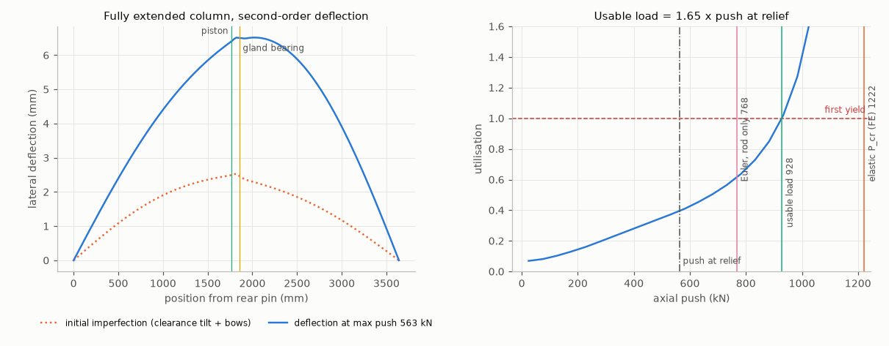


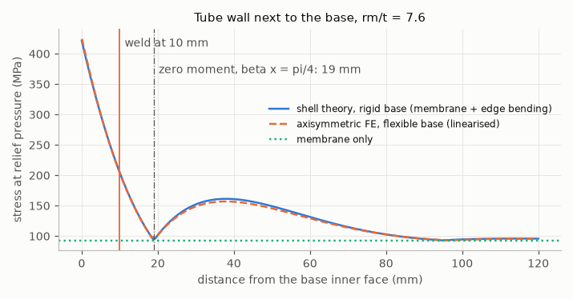


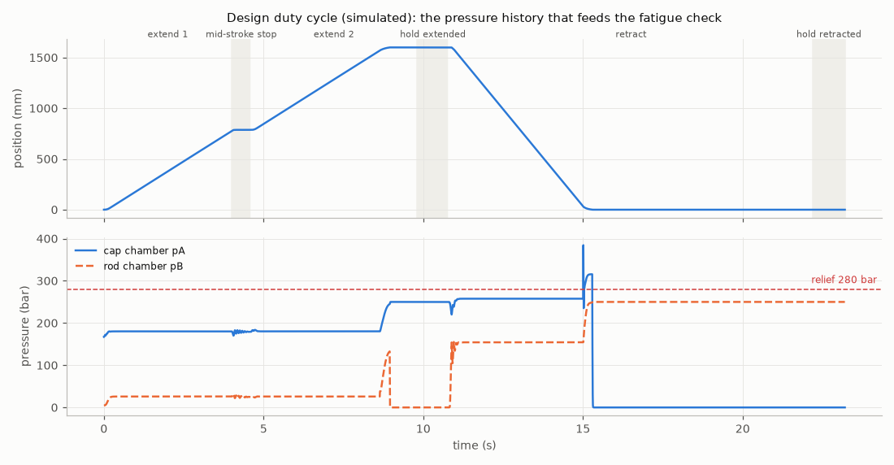


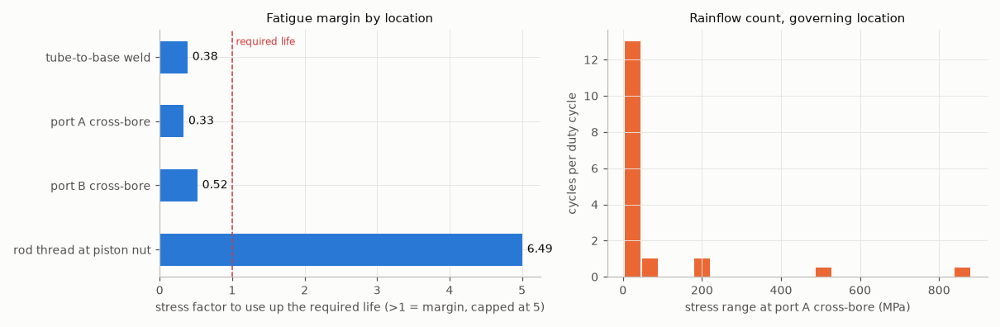


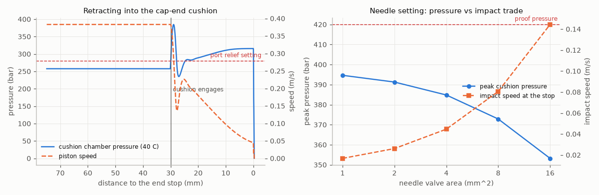


### rev B

Why this revision: rev A fails fatigue (base weld 0.38, ports through the tube wall 0.33) and the cap cushion reaches 445 bar with 0 C oil. Ports move into the base and head blocks, the girth weld moves to the zero-moment point of the edge bending (beta x = pi/4, 19 mm), the retract command is limited to 0.55 (interface requirement: the load overruns on retraction), and the cushion needle opens to 8 mm2.

| item | value |
|---|---|
| bore / rod / stroke | 160 / 100 / 1600 mm |
| rated / relief / supply | 250 / 280 / 250 bar |
| tube (sized) | E355+SR, OD 182.5 mm, wall 11.25 mm |
| base (sized) | 30 mm |
| rod | 42CrMo4+QT, Re 650 MPa (ruling section 100 mm) |
| pin-to-pin closed / extended | 2040 / 3640 mm |
| ports | in the base and head blocks |
| girth weld from base face | 19 mm |
| retract command limit | 0.55 |
| seals rod / piston | PTFE_step+PU / PTFE_compact |

**Requirements**

| ID | requirement | method | result | limit | status |
|---|---|---|---|---|---|
| R-01 | The cylinder shall extend at >= 190 mm/s against 330 kN with full valve command. | A (duty simulation); T (bench) | 199 mm/s | >= 190 mm/s | met |
| R-02 | Stress 'tube bore von Mises, relief pressure' shall not exceed 225 MPa (Pm). | A | 210 MPa | <= 225 MPa | met |
| R-03 | Stress 'tube bore von Mises, proof pressure' shall not exceed 450 MPa (proof). | A | 314 MPa | <= 450 MPa | met |
| R-04 | Stress 'base plate centre (simply supported bound), relief' shall not exceed 338 MPa (Pb). | A | 246 MPa | <= 338 MPa | met |
| R-05 | Stress 'tube wall at the base junction, membrane + edge bending, 0 -> relief' shall not exceed 900 MPa (PL+Pb+Q). | A | 422 MPa | <= 900 MPa | met |
| R-06 | Stress 'rod thread at piston, pull at relief (no preload credit)' shall not exceed 325 MPa (Pm). | A | 91 MPa | <= 325 MPa | met |
| R-07 | The fully extended cylinder shall reach first yield (with clearance tilt, bows, 1 mm pin eccentricity and self weight) only above 1.5 x the push at relief pressure. | A | 1.65 x (928 kN) | >= 1.50 | met (elastic P_cr 1222 kN; rod-only Euler 768 kN) |
| R-08 | Every fatigue-critical location shall survive 4e+05 design duty cycles with the partial factors applied (stress factor >= 1). | A; T (ISO 10771-1 Annex B type test) | tube-to-base weld: 1.03 | >= 1.00 | met |
| R-09 | The radial extrusion gap of the piston seal at relief pressure shall not exceed the seal's allowable gap. | A; I (clearances) | 0.199 mm | <= 0.31 mm | met |
| R-10 | The cushion chamber pressure shall not exceed the proof pressure (420 bar) in any end-of-stroke case, 0-40 C oil. | A; T (cushion test) | 324 bar (A end, 0 C) | <= 420 bar | met |
| R-11 | The piston shall reach the end stop at <= 0.10 m/s. | A; T | 0.080 m/s | <= 0.10 m/s | met |
| R-12 | Motion shall be free of stick-slip down to 10 mm/s. | A; T (ISO 10100 module F) | onset 1.8 mm/s | <= 10 mm/s | met |
| R-13 | Load-holding drift shall be <= 5 mm in 10 min. | A; T (ISO 10100 module P) | thermal 5.6 mm for 5 K cooling | <= 5 mm | NOT MET (the requirement holds only while the locked oil cools < 4.4 K in 10 min; the order must state the thermal condition) |
| R-14 | The lowest hydraulic natural frequency over the stroke shall be reported to the machine builder (TPM). | A | 11.0 Hz | report | met |
| R-15 | Where the order names an ISO mounting, the mounting interface dimensions shall comply with ISO 6022 (25 MPa series). | I (dimensional inspection) | pin-to-pin dimensions from the order file | standard's tables | open (the dimension tables are in the paid standard and were not available; the example orders give their own pin dimensions) |

**Static stresses**

| check | category | MPa | allow MPa | util | basis |
|---|---|---|---|---|---|
| tube bore von Mises, relief pressure | Pm | 210 | 225 | 0.93 | Lame closed end; Re/2 |
| tube bore von Mises, proof pressure | proof | 314 | 450 | 0.70 | Lame closed end; no yield at proof |
| base plate centre (simply supported bound), relief | Pb | 246 | 338 | 0.73 | simply supported plate; 1.5 Re/sf |
| base plate edge (clamped bound), relief | Pb | 149 | 338 | 0.44 | clamped plate; the real base lies between the bounds |
| tube wall at the base junction, membrane + edge bending, 0 -> relief | PL+Pb+Q | 422 | 900 | 0.47 | shell edge solution, rm/t = 7.6; shakedown 2 Re |
| rod axial stress, push at relief | Pm | 72 | 325 | 0.22 | F/A (column stability in buckling) |
| rod thread at piston, pull at relief (no preload credit) | Pm | 91 | 325 | 0.28 | F/As, ISO 898-1 stress area |

**Buckling (fully extended)**

| item | value |
|---|---|
| pin-to-pin length | 3640 mm |
| guide length (piston to gland bearing) | 85 mm, clearance tilt 2.65 mrad |
| push at relief pressure | 563 kN |
| Euler, rod only over pin-to-pin length | 768 kN |
| elastic critical load, stepped FE | 1222 kN (2.17 x push) |
| usable load (first yield with imperfections) | 928 kN (1.65 x push) |
| max deflection at push | 6.5 mm |
| reliability index (Re CoV 7 %, load CoV 10 %) | beta 4.25, Pf 1.1e-05 |

**Fatigue (duty-cycle simulation -> rainflow -> Miner)**

| location | basis | max stress MPa | damage / duty | life (duty cycles) | required | stress factor |
|---|---|---|---|---|---|---|
| tube-to-base weld | structural stress at 19 mm from the base by axisymmetric FE (3.53 x p; rigid-base shell solution 3.33 x p), EN 1993-1-9 cat 71 | 107 | 2.31e-06 | 4.32e+05 | 4e+05 | 1.03 |
| port A cross-bore | port in the end block, Kt 3 | 91 | 0.00 | inf | 4e+05 | 3.25 |
| port B cross-bore | port in the end block, Kt 3 | 75 | 0.00 | inf | 4e+05 | 3.95 |
| rod thread at piston nut | phi_n 0.3 x pull / As, M72x3, VDI 2230 endurance 40 MPa | 24 | 0.00 | inf | 4e+05 | 7.05 |

Equal-damage constant-amplitude test pressure for the governing location (tube-to-base weld): 183 bar for 1e6 cycles, 145 bar for 2e6 cycles.


**Cushioning**

| end | oil C | entry m/s | energy kJ | peak bar | impact m/s |
|---|---|---|---|---|---|
| B (rod end, extending) | 40 | 0.199 | 0.12 | 116 | 0.080 |
| B (rod end, extending) | 0 | 0.199 | 0.12 | 123 | 0.076 |
| A (cap end, retracting) | 40 | 0.211 | 0.13 | 304 | 0.076 |
| A (cap end, retracting) | 0 | 0.211 | 0.13 | 324 | 0.071 |

Without cushions the cap-end impact speed would be 0.211 m/s.


**Friction, smoothness, drift, natural frequency**

| item | value |
|---|---|
| holding pressure (load / A_A) | 164 bar |
| breakaway friction at holding pressure (model) | 596 N |
| stick-slip onset, linear criterion dF/dv < 0 | 1.8 mm/s |
| stick-slip simulation | 0.9 mm/s: stick-slip, 3.6 mm/s: smooth, 10.0 mm/s: smooth |
| thermal drift, locked cap chamber, 5 K cooling | 5.6 mm (requirement holds only for < 4.4 K) |
| piston seal leakage budget left | 0.00 ml/min |
| hydraulic natural frequency at mid stroke: formula / model eigenvalue | 11.68 / 11.68 Hz |
| damping ratio at null (critical-centre valve, no leakage) | 0.0024 |
| position-loop velocity gain limit: model / Merritt 2 zeta omega | 1.92 / 0.35 1/s |

**FMEA** (occurrence from the computed margin, rule in fmea.py)

| failure mode | cause | effect | S | margin | O | D | RPN | verification |
|---|---|---|---|---|---|---|---|---|
| tube-to-base weld fatigue crack | pressure cycles x edge bending at the weld root; root defect | external leak, possible base separation | 10 | 1.03 (fatigue stress factor) | 7 | 7 | 490 | Q-1 type test; weld root NDT |
| drift under load | piston seal leakage; oil cooling in the locked chamber | load creeps down | 7 | 0.89 (drift allowance / thermal drift) | 9 | 5 | 315 | P-1 leakage test (thermal part only by analysis) |
| rod / column buckling | push above usable load at full extension; worn bearings increase the tilt | bent rod, uncontrolled load drop | 10 | 1.65 (usable load / push at relief) | 3 | 6 | 180 | analysis only (R-07); clearance inspection I-1 |
| rod thread / piston nut fatigue | pull cycles; preload loss raises the alternating share (phi_n -> 1) | piston separates from rod, loss of load | 10 | 7.05 (fatigue stress factor (with preload)) | 2 | 8 | 160 | torque check at assembly; Q-1 |
| cushion over-pressure | trapped cushion oil is not protected by the port relief; cold oil | seal extrusion, fatigue damage, tube yield | 8 | 1.30 (proof pressure / cushion peak) | 5 | 4 | 160 | C-1 cushion test with chamber transducer |
| port cross-bore fatigue crack | pressure cycles x hole stress concentration | external leak at the port | 7 | 3.25 (fatigue stress factor) | 2 | 7 | 98 | Q-1 type test |
| piston seal extrusion | extrusion gap grows with clearance wear and bore dilation | internal leak, drift, seal debris | 6 | 1.56 (allowable gap / gap at relief) | 3 | 5 | 90 | I-1 clearances; P-1 leakage |
| aerated oil / spongy motion | air entrainment, poor bleeding | low natural frequency, overshoot, cavitation erosion | 5 | 2.00 (not quantified as a margin (natural frequency reported as TPM)) | 2 | 5 | 50 | commissioning bleed procedure |
| stick-slip / jerky motion | static/Coulomb friction ratio too high; seal swell; low speed | poor positioning, noise, wear | 5 | 5.52 (smooth-speed requirement / stick-slip onset) | 2 | 4 | 40 | F-1/F-2 friction test |

**Acceptance test procedure (limits derived from this analysis)**

| step | module | test | pass limit | why |
|---|---|---|---|---|
| I-1 | inspection | piston guide and gland bearing diametral clearance | <= 0.25 / 0.20 mm | sets the buckling tilt (R-07) and the extrusion gap (R-09) |
| L-1 | ISO 10100 sec. 8.2 | leakage at low test pressure, sight test | no external leakage (test pressure per ISO 10100) | standard module |
| L-2 | ISO 10100 sec. 8.3 | proof / external leakage test | no external leakage, no permanent set; analysis at 420 bar gives 314 MPa < Re 450 MPa | R-03; the proof pressure value must be taken from ISO 10100 (here 1.5 x max(rated, relief) is assumed) |
| P-1 | ISO 10100 sec. 9 | piston seal leakage at rated pressure, cap side | no budget left: thermal contraction alone uses the R-13 allowance (open with the customer) | the share of the R-13 drift budget left after thermal contraction |
| F-1 | ISO 10100 sec. 10.6.2 | static (breakaway) friction, unloaded | <= 410 N (1.3 x model) | the friction the speed and smoothness analyses assumed (R-01, R-12) |
| F-2 | ISO 10100 sec. 10.4.2 | friction at constant speed, both directions, 0.1-100 mm/s; fit the Stribeck model | stick-slip onset of the fitted curve <= 10 mm/s (model: 1.8 mm/s) | R-12; and it validates the seal model. An unloaded rig sees only the low-pressure static excess: run it with back pressure at the holding pressure if the rig allows |
| C-1 | project test (not in ISO 10100) | run into both ends at full speed, 0 C and 40 C oil; record the cushion chamber pressure | peak <= 420 bar; impact <= 0.10 m/s | R-10, R-11 (needs a transducer in the cushion chamber, not at the port) |
| Q-1 | ISO 10771-1 Annex B (type test, once per design) | cyclic pressure test 0 -> p_test, 1e6 cycles | p_test >= 183 bar on the A side, no failure | same Miner damage at tube-to-base weld as the design life (R-08); equal-damage pressure for 2e6 cycles: 145 bar |

Bench evaluation demo on SYNTHETIC data (calibrated model + 1 % + 5 N noise; not a real test): fitted Coulomb 270 N, static excess 34 N, Stribeck speed 0.39 mm/s. F-1 PASS (307 <= 410 N); F-2 PASS (1 <= 10 N).


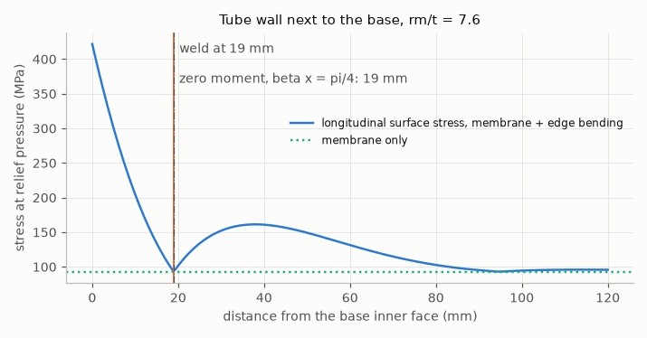


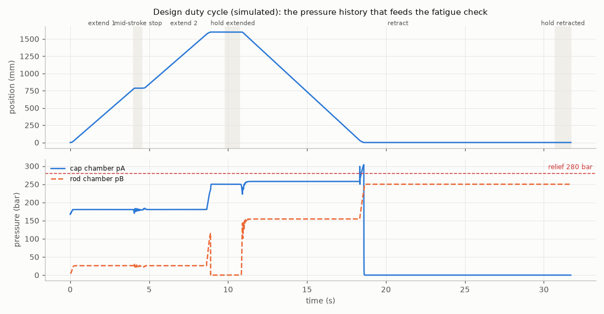


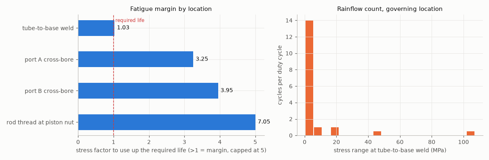


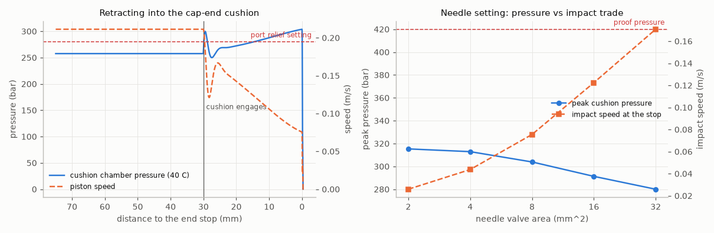


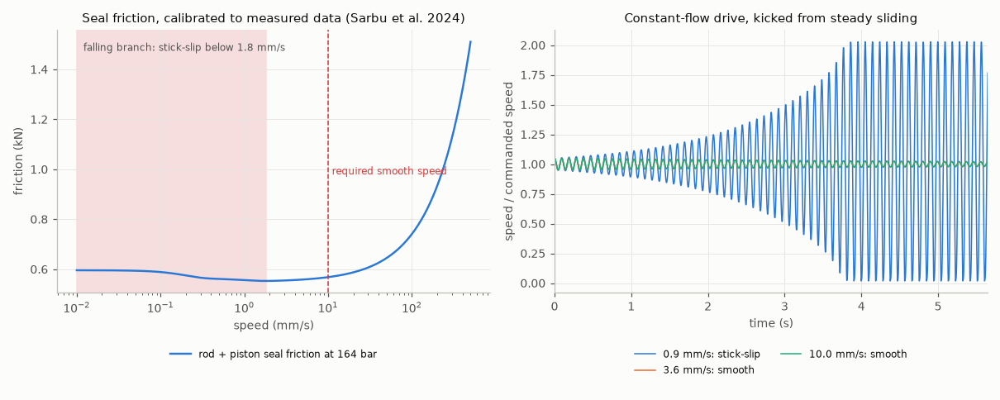


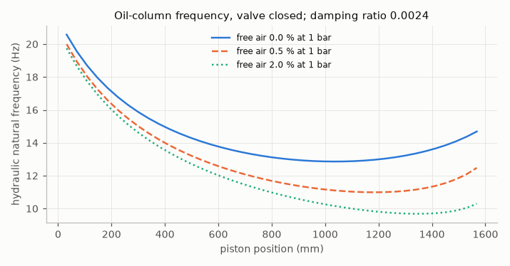


## Trade studies (final revision rev B)


**Seal system** - rank: PU U-cup + PU compact > PTFE step seal + PU tandem, PTFE piston. Weight changes of +-10 % that flip the winner: none. Share of 2000 random weight sets won: PU U-cup + PU compact 59 %, PTFE step seal + PU tandem, PTFE piston 41 %.

| alternative | smooth motion (model) (25) | friction loss (model) (10) | extrusion margin (model) (20) | dry rod / static tightness (judgement) (20) | contamination tolerance (judgement) (15) | cost (judgement) (10) | total |
|---|---|---|---|---|---|---|---|
| PU U-cup + PU compact | 3.2 | 10.0 | 0.5 | 8.0 | 7.0 | 8.0 | 5.35 |
| PTFE step seal + PU tandem, PTFE piston | 3.7 | 10.0 | 2.8 | 7.0 | 6.0 | 5.0 | 5.28 |

Computed inputs: PU U-cup + PU compact: stick-slip onset mm/s 2.32, friction % of thrust 0.25, extrusion margin 1.10; PTFE step seal + PU tandem, PTFE piston: stick-slip onset mm/s 1.81, friction % of thrust 0.19, extrusion margin 1.56


Judgement rationale: *dry rod / static tightness*: PU lips seal well at low pressure; PTFE step seals rely on the secondary PU seal for a dry rod. *contamination tolerance*: PU is the more abrasion-tolerant lip material in dirty mobile service. *cost*: PTFE systems need more parts (energiser, back-up) and tighter groove tolerances.


**Rod surface** - rank: HVOF WC-CoCr thermal spray > laser cladding (Ni-base alloy) > nitrocarburise + post-oxidise > hard chrome (Cr VI electroplate). Weight changes of +-10 % that flip the winner: none. Share of 2000 random weight sets won: hard chrome (Cr VI electroplate) 6 %, HVOF WC-CoCr thermal spray 65 %, laser cladding (Ni-base alloy) 24 %, nitrocarburise + post-oxidise 6 %.

| alternative | corrosion resistance (25) | wear / impact resistance (20) | regulatory risk (20) | cost (15) | long-rod capability (10) | field repairability (10) | total |
|---|---|---|---|---|---|---|---|
| hard chrome (Cr VI electroplate) | 6.0 | 6.0 | 2.0 | 9.0 | 9.0 | 8.0 | 6.15 |
| HVOF WC-CoCr thermal spray | 7.0 | 9.0 | 9.0 | 4.0 | 6.0 | 5.0 | 7.05 |
| laser cladding (Ni-base alloy) | 9.0 | 7.0 | 9.0 | 3.0 | 6.0 | 4.0 | 6.90 |
| nitrocarburise + post-oxidise | 6.0 | 5.0 | 9.0 | 8.0 | 7.0 | 3.0 | 6.50 |

Judgement rationale: *regulatory risk*: Cr(VI) for hard chrome needs REACH authorisation today; ECHA submitted a restriction dossier on 11 Apr 2025, consultation ran to 18 Dec 2025, RAC/SEAC opinions pending in May 2026 (Freyr, 25 May 2026). Score 2 = real chance the process must change during the product life.. *corrosion / wear / cost / capability / repairability*: engineering judgement from published comparisons, NOT measured here; a neutral salt-spray (ISO 9227) and an abrasion test on coupons would replace these scores.


**Tube material** - rank: E355+SR > 25CrMo4+QT. Weight changes of +-10 % that flip the winner: none. Share of 2000 random weight sets won: E355+SR 100 %, 25CrMo4+QT 0 %.

| alternative | mass (model) (10) | weld fatigue (model) (25) | port fatigue (model) (15) | weldability (judgement) (20) | availability honed (judgement) (15) | cost (judgement) (15) | total |
|---|---|---|---|---|---|---|---|
| E355+SR | 4.6 | 3.5 | 10.0 | 9.0 | 9.0 | 8.0 | 7.19 |
| 25CrMo4+QT | 7.0 | 0.3 | 10.0 | 5.0 | 5.0 | 5.0 | 4.77 |

Computed inputs: E355+SR: wall mm 11.25, kg/m 47.51, port fatigue factor 3.25, weld fatigue factor 1.03; 25CrMo4+QT: wall mm 7.50, kg/m 30.98, port fatigue factor 4.48, weld fatigue factor 0.54


Judgement rationale: *weldability*: CrMo grades need preheat and controlled cooling at the base and head welds. *availability / cost*: E355 honed tube is the stock cylinder tube; CrMo tube is a special order.


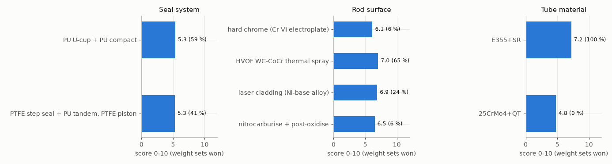

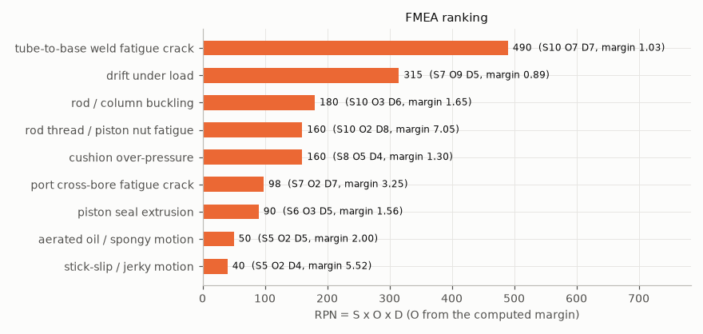


## Manufacturing hand-off (final revision) to the CNC part-family generator

Rows derived from the verified design (groove sizes illustrative, by size band):

```json
{
 "rod_end": {
  "id": "RE-HD-160-revB",
  "rod_d": 100.0,
  "thread_d": 72,
  "pitch": 3,
  "thread_len": 61,
  "relief_w": 8,
  "spigot_d": 75,
  "spigot_len": 61,
  "chamfer": 3,
  "material": "42CrMo4"
 },
 "piston": {
  "id": "PI-HD-160-revB",
  "bore_d": 160.0,
  "od_clear": 0.3,
  "inner_d": 75,
  "length": 80,
  "seal_w": 24.0,
  "seal_bottom_d": 133.0,
  "guide_w": 8.4,
  "guide_bottom_d": 152.5,
  "guide_inset": 4.0,
  "chamfer": 1,
  "stock_d": 165.0,
  "material": "C45"
 },
 "gland": {
  "id": "GL-HD-160-revB",
  "rod_d": 100.0,
  "id_clear": 0.2,
  "od": 159.95,
  "length": 110,
  "oring_w": 6.0,
  "oring_bottom_d": 151.2,
  "oring_z": 75,
  "wiper_w": 7.9,
  "wiper_bottom_d": 112.5,
  "wiper_z": 2,
  "seal_w": 10.1,
  "seal_bottom_d": 115.0,
  "seal_z": 28,
  "guide_w": 7.0,
  "guide_bottom_d": 106.25,
  "guide_z": 55,
  "chamfer": 1,
  "stock_d": 165.0,
  "material": "C45"
 }
}
```

| part | 07 generate + verify | tool library | lines | cycle time s |
|---|---|---|---|---|
| RE-HD-160-revB | PASS | 07 base library | 81 | 547.2 |
| PI-HD-160-revB | PASS | 07 base library | 169 | 2378.0 |
| GL-HD-160-revB | PASS | 07 library + heavy ID grooving bar (10 mm reach; groove 7.40 mm deep) | 170 | 3758.2 |
